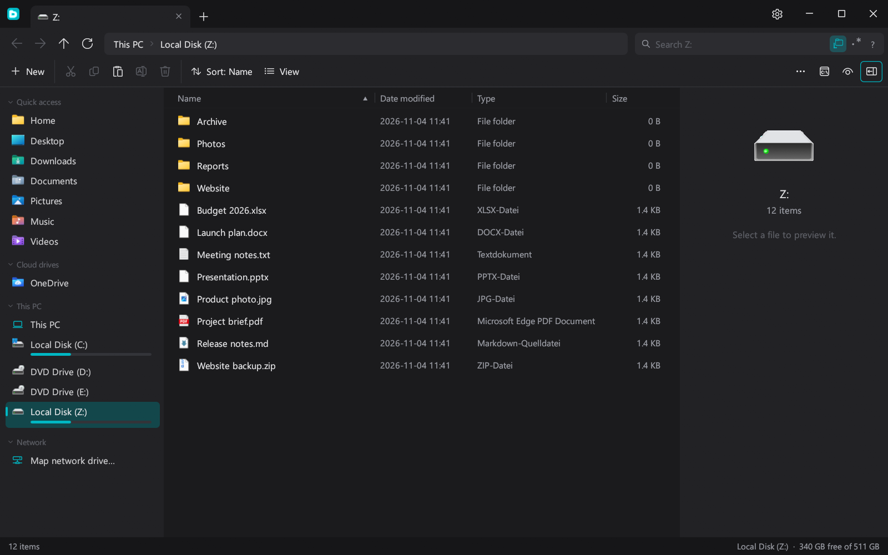

<div align="center">


# Daleris

**A file explorer built for speed, with everything you expect from a modern one.**

Native, written in Rust, with no web view and no runtime to install.

[](https://github.com/MyDrift-user/daleris/actions/workflows/ci.yml)




</div>

---

## ✨ Features

### ⚡ Fast search
A parallel crawler builds a compact in-memory index of the folder. The first search streams matches while it crawls, and every later keystroke searches the finished index on all CPU cores.

| Query | Finds |
|---|---|
| `report` | names containing "report" |
| `"final report"` | that exact text |
| `*.log` or `img_??` | wildcard matches |
| `-draft` | leaves out names containing "draft" |
| `ext:pdf` | files of one type |
| `size:>100mb` or `size:1g..5g` | files by size |
| `modified:today` or `date:>2026-01-01` | files by date |
| `hidden:yes` | hidden items |
| `/^img_\d+/` or `re:^img_\d+` | regular expressions |

### 🗂️ Everyday file management
- Tabs, with back, forward and up navigation and an editable address bar
- List and large icon views, with sorting and resizable columns
- Folder sizes counted in the background
- Preview pane for text files and folder summaries, plus a details panel for files
- Cut, copy, paste, rename and delete, including drag and drop

### ☁️ Cloud and network drives
- OneDrive, Google Drive, Dropbox and iCloud Drive folders appear in the sidebar
- On Windows, **Always keep on this device** and **Free up space** work directly from the menu
- Files that are only in the cloud aren't downloaded just to show a preview
- Map network drives on Windows, or connect to SMB and SFTP servers on Linux and macOS

### 🖱️ Native Windows integration
The real Windows icons, thumbnails and right-click menu, so your shell extensions keep working. You can also add your own commands to the menu, using `{path}`, `{paths}`, `{name}` and `{dir}`.

### 🎨 Make it yours
- Dark, light or follow Windows, with a choice of accent colours
- Icon packs: Daleris, with its own drawings for hundreds of file types, Phosphor, the real Windows icons on Windows, or your own pack made from PNG files
- A sidebar and ribbon bar you can rearrange
- A custom title bar, or the standard one

### 🏢 Ready for IT departments
You can manage every setting as a fixed value or a default: on Windows through **Group Policy (ADMX/ADML in English and German)** or Group Policy Preferences, and on Linux and macOS through a file only administrators can change. Open windows pick up changes within 30 seconds. See [`policy/README.txt`](policy/README.txt).

## ⌨️ Keyboard shortcuts

`Ctrl` is `Cmd` on macOS.

| Keys | Action |
|---|---|
| `Ctrl+T` / `Ctrl+W` | New tab / close tab |
| `Ctrl+Tab` | Next tab |
| `Ctrl+1`…`Ctrl+9` | Jump to a tab (`9` is the last one) |
| `Ctrl+F` or `F3` | Search |
| `Ctrl+L` or `Alt+D` | Edit the address |
| `Alt+←` / `Alt+→` / `Alt+↑` | Back / forward / up |
| `F5` | Refresh |
| `Ctrl+Shift+N` | New folder |
| `Alt+P` | Show or hide the preview pane |

---

## 📦 Install

Download what you need from **[Releases](../../releases)**:

| System | File | What it is |
|---|---|---|
| Windows 10 / 11 (x64) | `...-windows-x64-setup.exe` | Installer, for this PC or just your account |
| | `...-windows-x64.msi` | MSI installer with a setup wizard, or silent for managed deployment |
| | `...-windows-x64-portable.exe` | Portable, runs without installing |
| | `...-windows-x64.zip` | The same portable program, zipped |
| | `...-policy-definitions.zip` | Group Policy templates |
| Linux (x64 or arm64, X11 and Wayland) | `...-linux-*.AppImage` | Runs on most distros without installing |
| | `...-linux-*.deb` | Debian, Ubuntu, Mint and others |
| | `...-linux-*.rpm` | Fedora, openSUSE and others |
| | `...-linux-x64.pkg.tar.zst` | Arch Linux and others |
| | `...-linux-*`, `...-linux-*.tar.gz` | Program, or the same in an archive |
| macOS 11+ (Apple Silicon `arm64` or Intel `x64`) | `...-macos-*.dmg` | Disk image, drag to Applications |
| | `...-macos-*.pkg` | Installer, for managed deployment |
| | `...-macos-*`, `...-macos-*.tar.gz` | Program, or the same in an archive |

Both Windows installers can install for this PC or for just your account. To install without any screens:

```bat
:: For this PC, from an administrator prompt. The folder is optional.
msiexec /i daleris-windows-x64.msi /qn ALLUSERS=1 APPLICATIONFOLDER="D:\Apps\Daleris"
daleris-windows-x64-setup.exe /VERYSILENT /ALLUSERS /DIR="D:\Apps\Daleris"

:: For one account, without admin rights.
msiexec /i daleris-windows-x64.msi /qn ALLUSERS=2 MSIINSTALLPERUSER=1
daleris-windows-x64-setup.exe /VERYSILENT /CURRENTUSER
```

Windows is the main platform. The Linux and macOS packages are tested automatically when they're built, but aren't yet tested in daily use. After downloading an AppImage or plain program, make it runnable with `chmod +x`.

Nothing is signed by a known publisher, so SmartScreen may show a warning on Windows. On macOS, run `xattr -dr com.apple.quarantine "/Applications/Daleris.app"` if it's blocked.

Bug reports for Linux and macOS are especially welcome.

## ⚙️ Settings file and logs

Settings are a plain text file with one `name=value` per line, also shown under **Settings → Files & folders**. Open windows read it again when they get focus.

| System | Settings and `icon packs` | Log |
|---|---|---|
| Linux | `~/.config/daleris/` | `~/.local/state/daleris/daleris.log` |
| macOS | `~/Library/Application Support/Daleris/` | `~/Library/Logs/Daleris/daleris.log` |
| Windows | `%APPDATA%\Daleris\` | `%LOCALAPPDATA%\Daleris\logs\daleris.log` |

The log records the system, graphics driver, errors and crashes with a backtrace. Set `DALERIS_LOG=debug` for more detail. **When reporting a crash, please attach this file.**

## 🔄 Updates

Daleris looks for a new release at startup and every 6 hours, and installs it by itself unless you turn that off under **Settings → Files & folders → Updates**. How depends on how it's installed:

| Installed as | How updates land |
|---|---|
| For one account (MSI or `setup.exe`) | Installed silently when you close Daleris |
| For this PC (MSI or `setup.exe`) | A scheduled task, `Daleris Updater`, installs it as SYSTEM once Daleris is closed, within about an hour. No admin prompts. The install folder is locked so only administrators can change it |
| Portable, AppImage, macOS app | Replaces itself, in use from the next start |
| `.deb`, `.rpm`, Arch package | Tells you, then asks for your password when you choose to install |

Every release lists its files' checksums in `latest.json`, signed in `latest.json.sig`. Daleris checks that signature against a key built into it, and refuses anything that doesn't match. Administrators can fix automatic updates on or off with the **AutomaticUpdates** policy, or stop Daleris looking for updates at all with **DisableUpdates**. `daleris --update-now` does an update check from a script.

## 🛠️ Build from source

You need [Rust](https://rustup.rs).

```sh
cargo build --release
```

The program ends up in `target/release/`.

On Debian or Ubuntu, install these libraries first:

```sh
sudo apt install libxkbcommon-dev libgl1-mesa-dev libwayland-dev libx11-dev
```

## 🚀 Releasing

Every push is built on all three systems by the CI workflow. Releases only start by hand:

1. Raise `version` in `Cargo.toml` and push. A version can't change once it's released, because updates go by the number.
2. Go to **Actions → Release → Run workflow**. Turning off **Publish** only builds and tests, leaving the files on the run.

Publishing waits for an approval on GitHub, as the signing key is a secret of the protected `release` environment. If that key is lost or leaks, a release signed with the offline backup key can still reach every copy, and replace it.

The workflow builds every download, installs and starts the Linux and macOS packages to test them (Linux on clean distro containers), checks that the Windows installers install and uninstall, tags `v<version>` and publishes a GitHub Release with the downloads. 

## 🗺️ Project layout

```
src/
  main.rs                 entry point
  app.rs, app/            the interface: tabs, list, sidebar, menus, properties, settings
  search.rs               parallel crawler, index and query language
  dirsize.rs              background folder sizes
  fsx.rs, shell.rs        Windows file system and shell integration
  fsx_unix.rs, shell_unix.rs  the same for Linux and macOS
  policy.rs               Group Policy
  theme.rs                colours, icons and logo
policy/                   ADMX / ADML templates
assets/logos/             the logo as SVG; build.ps1 makes the app and installer icons from one
installer/                setup.exe (Inno Setup) and MSI (WiX) definitions
  linux/, macos/          AppImage, deb, rpm, Arch, dmg and pkg packaging and tests
```

## 📄 License

Copyright (C) 2026 MyDrift. Daleris is free software, released under the [GNU General Public License v3.0](LICENSE). The optional Phosphor icon pack and the Linux and macOS toolbar use [Phosphor](https://phosphoricons.com), which is MIT licensed: see [the notices](THIRD-PARTY-NOTICES.txt).

---

<div align="center">
<sub>Made with 🦀 Rust and <a href="https://github.com/emilk/egui">egui</a>.</sub>
</div>
