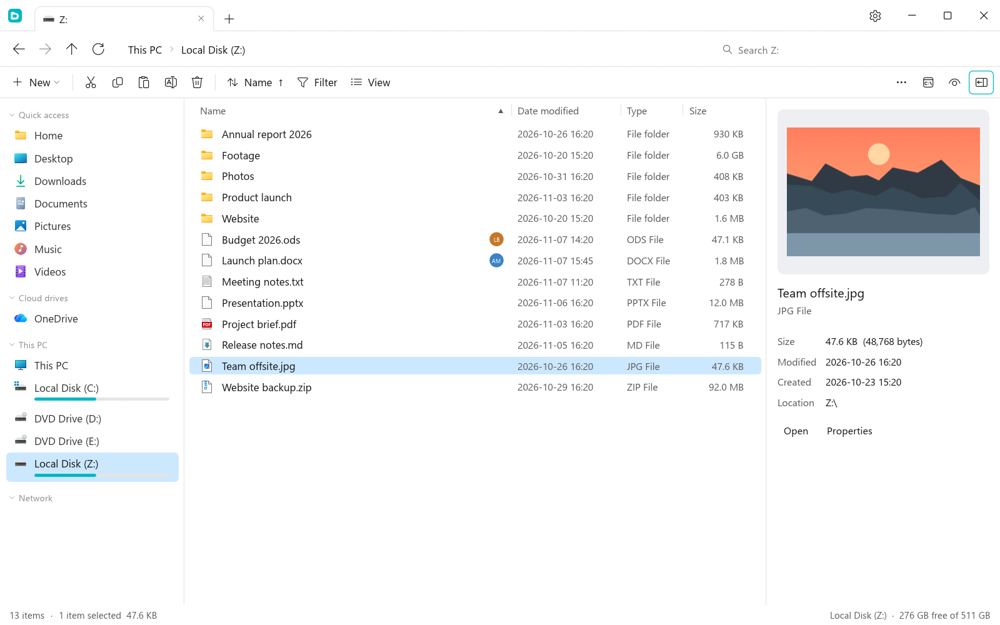
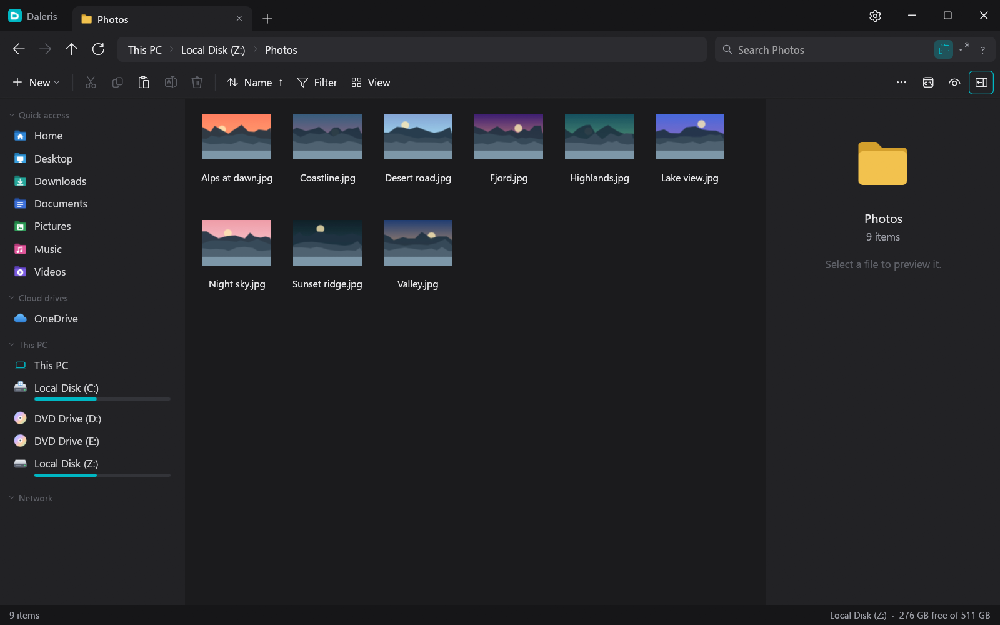
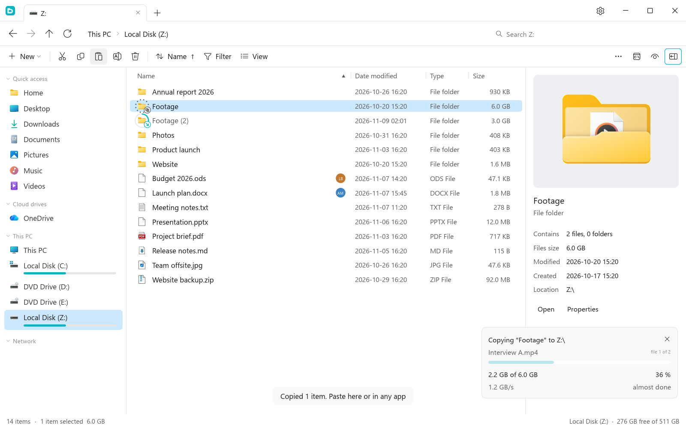
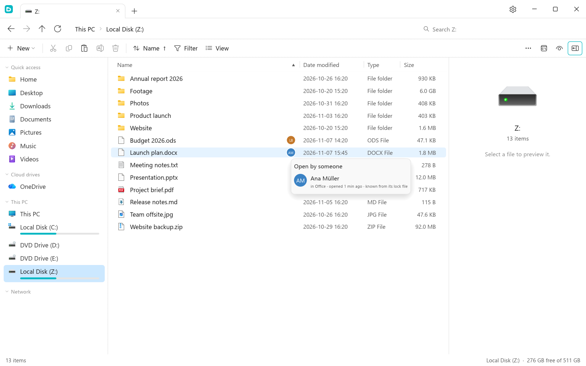
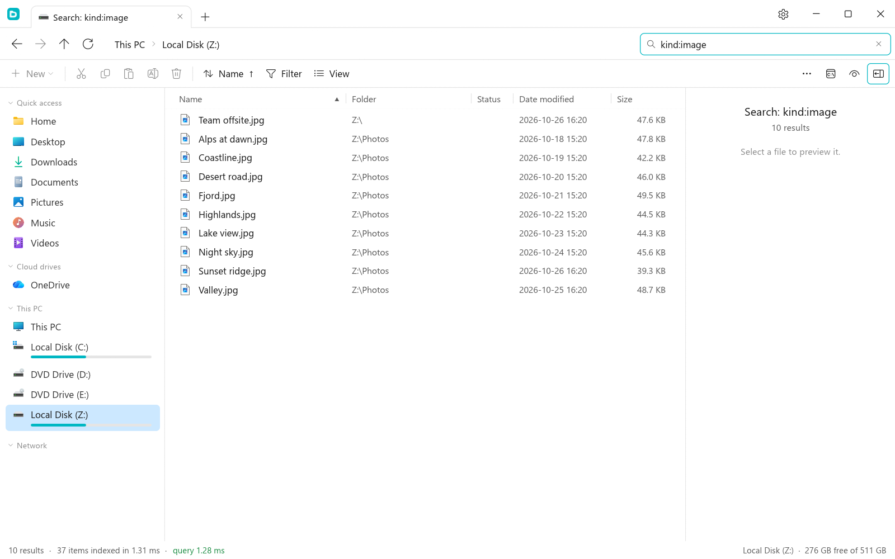
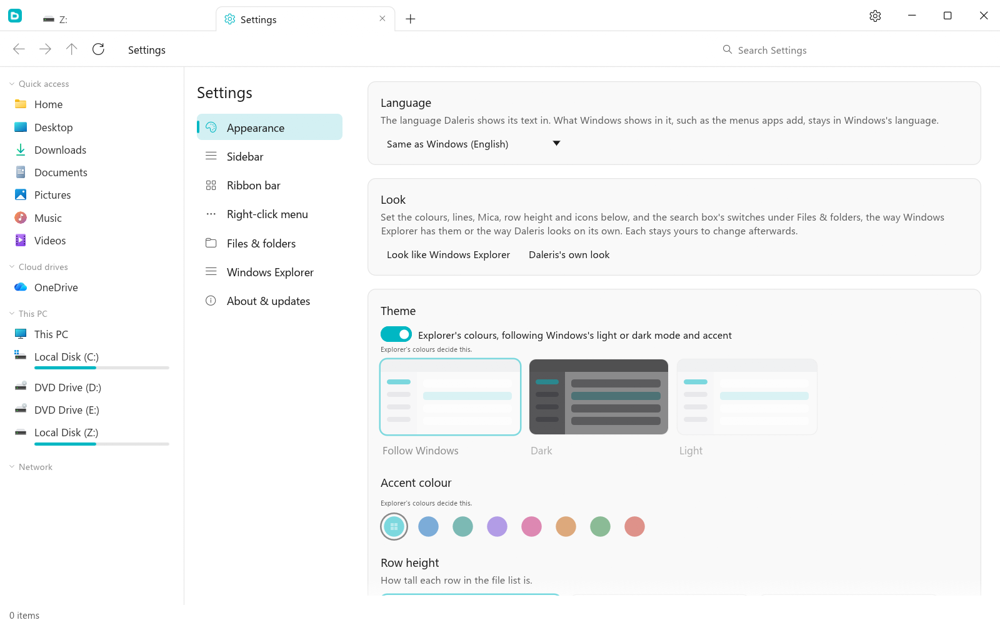
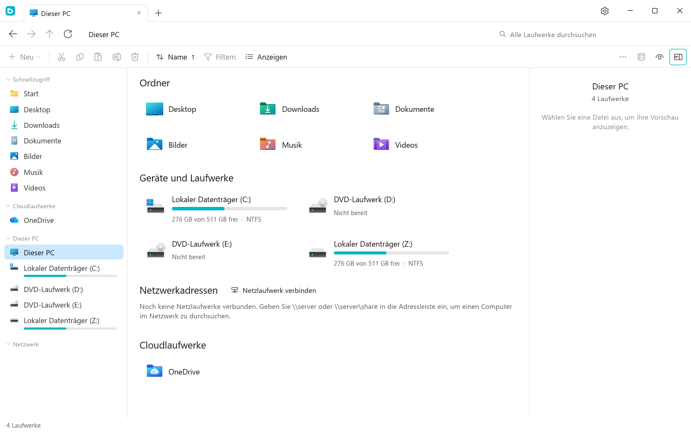

<div align="center">


# Daleris

**A file explorer built for speed, with everything you expect from a modern one.**

Native, written in Rust, with no web view and no runtime to install.

[](https://github.com/MyDrift-user/daleris/actions/workflows/ci.yml)




</div>

---

## 💡 Why Daleris

- **It's fast.** A native program, no web view. Big folders list as they load, folder sizes count in the background, and search answers from an index in milliseconds.
- **It feels like home.** On Windows it looks like File Explorer out of the box, with Windows's own icons, right-click menu and Mica. Or give it a look of its own.
- **You see what's happening.** Copies and moves show on the files themselves, and you see who has a file open, on this PC or on a share.
- **It never hangs on a server.** A share that's down says so in plain words and keeps trying, while the rest of the window works.
- **It's yours to shape,** from the ribbon bar and the right-click menu to the sidebar and what search leaves out.
- **It speaks your language:** English, German or Italian, following Windows.
- **It's ready for organizations:** every setting can be fixed or preset by Group Policy, and it can stand in for File Explorer.
- **It's free and open source,** for Windows, Linux and macOS.

## ✨ Features

### 🪟 Looks like Explorer, or like itself
Out of the box on Windows, Daleris has Explorer's colours, lines, Mica, icons and compact rows. One button in **Settings → Appearance** gives it Daleris's own look instead, with its own icon set, a dark or light theme and an accent colour; each part stays a setting of its own.

<p align="center"></p>

### 📦 See what's happening to your files
A copy or move shows on the item itself: a ring filling with its progress, and badges for where it's copied from and what's being written. The progress card has the speed and time left, and conflicts ask once, with both files side by side.

<p align="center"></p>

**Who has a file open** shows as a picture next to its name: programs on this PC, people named by Office's and LibreOffice's lock files, and, on a network share, other people's Daleris, with what they copy, move or delete there. Point at it for who, in which program and since when.

<p align="center"></p>

### ⚡ Fast search
A parallel crawler builds a compact in-memory index of the folder. The first search streams matches while it crawls, and every later keystroke searches the finished index on all CPU cores. Folders you never want searched, such as app data or `node_modules`, are left out by default.

<p align="center"></p>

| Query | Finds |
|---|---|
| `report` | names containing "report" |
| `"final report"` | that exact text |
| `*.log` or `img_??` | wildcard matches |
| `-draft` | leaves out names containing "draft" |
| `ext:pdf` | files of one type |
| `kind:image` | pictures, and likewise `video`, `audio`, `doc`, `code`, `archive`, `app`, `folder` |
| `size:>100mb` or `size:1g..5g` | files by size |
| `modified:today` or `date:>2026-01-01` | files by date |
| `hidden:yes` | hidden items |
| `/^img_\d+/` or `re:^img_\d+` | regular expressions |

### 🎨 Make it yours
- Daleris's look or Explorer's, dark, light or following Windows, with a choice of accent colours
- Icon packs: Daleris, with its own drawings for hundreds of file types, Phosphor, the real Windows icons on Windows, or your own pack made from PNG files
- A sidebar, ribbon bar and right-click menu you can rearrange, hide parts of and add your own commands to, using `{path}`, `{paths}`, `{name}` and `{dir}`
- Where new tabs open, which switches the search box shows, whether the logo is the settings button, and a custom title bar or the standard one

<p align="center"></p>

### 🌍 Speaks your language
English, German and Italian, following the language Windows is shown in, or chosen in **Settings → Appearance**. Numbers and dates are written the way each language writes them, and the installers follow Windows's language too.

<p align="center"></p>

### 🗂️ Everyday file management
- Tabs that open This PC, Home or a folder of your choice, with back, forward and up, an editable address bar, and tabs you can drag into a window of their own
- List and large icon views, with resizable columns
- A Sort menu with name, dates, type, extension and size, and **Folders first** as its own switch. Each folder keeps the sort you choose for it, and Downloads opens newest first
- A filter panel for kind, extension, date, size and name, per tab, showing how much of the folder it leaves on screen
- Folder sizes counted in the background
- Preview pane for pictures, text files and folder summaries, plus a details panel for files
- Cut, copy, paste, rename and delete, including drag and drop onto folders, tabs, the sidebar and any part of the path

### ☁️ Cloud and network drives
- OneDrive, Google Drive, Dropbox and iCloud Drive folders appear in the sidebar
- On Windows, **Always keep on this device** and **Free up space** work directly from the menu
- Files that are only in the cloud aren't downloaded just to show a preview
- Map network drives on Windows, or connect to SMB and SFTP servers on Linux and macOS
- A server that's down never holds up the window: a folder says what it's waiting for, says in plain words what went wrong, keeps trying, and opens once the server answers. Unavailable drives look it in the sidebar and come back by themselves
- A drive locked by BitLocker says so, and opens once you unlock it

### 🖱️ Native Windows integration
The real Windows icons, thumbnails and right-click menu, so your shell extensions keep working, and right-clicking the title bar gives Windows's own window menu.

### 🪟 Stands in for File Explorer (Windows, optional)
Under **Settings → Windows Explorer** there are separate switches, all off by default, to open folders in Daleris, make Win + E open it, select the file on "Show in folder", open new folders as tabs in the running window, show Daleris for apps' Open and Save dialogs, and send an ordinary file dialog to the folder Daleris shows with Ctrl + G. Each switch says whether it's really active. [What each one does, and its limits.](#-windows-explorer-integration)

### 🏢 Ready for IT departments
You can manage every setting as a fixed value or a default, including the language and what search never finds: on Windows through **Group Policy (ADMX/ADML in English, German and Italian)** or Group Policy Preferences, and on Linux and macOS through a file only administrators can change. Open windows pick up changes within 30 seconds. See [`PolicyDefinitions/README.txt`](PolicyDefinitions/README.txt).

## ⌨️ Keyboard shortcuts

`Ctrl` is `Cmd` on macOS.

| Keys | Action |
|---|---|
| `Ctrl+T` / `Ctrl+W` | New tab / close tab |
| `Ctrl+Shift+T` | New tab in the same folder |
| `Ctrl+Tab` | Next tab |
| `Ctrl+1`…`Ctrl+9` | Jump to a tab (`9` is the last one) |
| `Ctrl+F` or `F3` | Search |
| `Ctrl+L` or `Alt+D` | Edit the address |
| `Alt+←` / `Alt+→` / `Alt+↑` | Back / forward / up |
| `F5` | Refresh |
| `Ctrl+Shift+N` | New folder |
| `Alt+P` | Show or hide the preview pane |
| `Ctrl+,` | Settings |

---

## 📦 Install

Download what you need from **[Releases](../../releases)**:

| System | File | What it is |
|---|---|---|
| Windows 10 / 11 (x64) | `...-windows-x64-setup.exe` | Installer, for this PC or just your account |
| | `...-windows-x64.msi` | MSI installer with a setup wizard, or silent for managed deployment |
| | `...-windows-x64-portable.exe` | Portable, runs without installing |
| | `...-windows-x64.zip` | The same portable program, zipped |
| | `...-policy-definitions.zip` | Group Policy templates |
| Linux (x64 or arm64, X11 and Wayland) | `...-linux-*.AppImage` | Runs on most distros without installing |
| | `...-linux-*.deb` | Debian, Ubuntu, Mint and others |
| | `...-linux-*.rpm` | Fedora, openSUSE and others |
| | `...-linux-x64.pkg.tar.zst` | Arch Linux and others |
| | `...-linux-*`, `...-linux-*.tar.gz` | Program, or the same in an archive |
| macOS 11+ (Apple Silicon `arm64` or Intel `x64`) | `...-macos-*.dmg` | Disk image, drag to Applications |
| | `...-macos-*.pkg` | Installer, for managed deployment |
| | `...-macos-*`, `...-macos-*.tar.gz` | Program, or the same in an archive |

Both Windows installers can install for this PC or for just your account. To install without any screens:

```bat
:: For this PC, from an administrator prompt. The folder is optional.
msiexec /i daleris-windows-x64.msi /qn ALLUSERS=1 APPLICATIONFOLDER="D:\Apps\Daleris"
daleris-windows-x64-setup.exe /VERYSILENT /ALLUSERS /DIR="D:\Apps\Daleris"

:: For one account, without admin rights.
msiexec /i daleris-windows-x64.msi /qn ALLUSERS=2 MSIINSTALLPERUSER=1
daleris-windows-x64-setup.exe /VERYSILENT /CURRENTUSER
```

Windows is the main platform. The Linux and macOS packages are tested automatically when they're built, but aren't yet tested in daily use. After downloading an AppImage or plain program, make it runnable with `chmod +x`.

Nothing is signed by a known publisher, so SmartScreen may show a warning on Windows. On macOS, run `xattr -dr com.apple.quarantine "/Applications/Daleris.app"` if it's blocked.

Bug reports for Linux and macOS are especially welcome.

## ⚙️ Settings file and logs

Settings are a plain text file with one `name=value` per line, also shown under **Settings → About & updates**. Open windows read it again when they get focus.

| System | Settings and `icon packs` | Log |
|---|---|---|
| Linux | `~/.config/daleris/` | `~/.local/state/daleris/daleris.log` |
| macOS | `~/Library/Application Support/Daleris/` | `~/Library/Logs/Daleris/daleris.log` |
| Windows | `%APPDATA%\Daleris\` | `%LOCALAPPDATA%\Daleris\logs\daleris.log` |

The log records the system, graphics driver, errors and crashes with a backtrace. Set `DALERIS_LOG=debug` for more detail. **When reporting a crash, please attach this file.**

## 🪟 Windows Explorer integration

Every switch is off until you turn it on, works on its own and only changes your own account (HKCU). `daleris --restore-explorer` removes everything they wrote and nothing else, and uninstalling does the same.

| Switch | How it works | Limits |
|---|---|---|
| Open folders in Daleris | The `Folder` class's `open` and `explore` commands point at a small launcher | Apps that start `explorer.exe` themselves can't be redirected. The Recycle Bin, Control Panel and other places only Explorer can show go to it |
| Win + E opens Daleris | The setting Windows reads for this shortcut | Some Windows builds are reported to skip it |
| Win + E, even if Windows ignores that | A low-level keyboard hook in a small process of its own, started at sign-in | Doesn't see keys while an administrator window is in front. Some anti-cheat software may dislike keyboard hooks |
| "Show in folder" selects the file | The launcher registers as a shell window for a few seconds so `SHOpenFolderAndSelectItems` can tell it what to select | Undocumented, so an update could stop it. Only the first file of several is selected. `explorer.exe /select,` isn't redirected |
| New folders as tabs in the running window | A named pipe per user and session, with short timeouts | |
| Open and Save dialogs use Daleris | A per-user COM registration of `CLSID_FileOpenDialog` and `CLSID_FileSaveDialog`. Windows loads a small DLL into an app only when it creates one of these dialogs; the DLL starts Daleris as a separate process for the window | Old-style dialogs (`GetOpenFileName`, `SHBrowseForFolder`), Microsoft Store apps, elevated and sandboxed apps keep the Windows dialog. Controls the app adds are shown too; properties it collects, such as Office's Authors and Tags, aren't editable. Not offered on ARM PCs |
| Ctrl + G in a Windows file dialog | A small process, started at sign-in, watches the foreground window from outside and sends the dialog the path. Loads nothing into the app | Says so if Daleris isn't open. Can't reach apps running as administrator |
| Log file dialog decisions | The DLL writes which apps asked for a dialog, what it decided and why, the controls they added and any interface it doesn't know, to `%LOCALAPPDATA%\Daleris\logs\file-dialogs.log` | An app that isn't in the log never asked Windows for this kind of dialog |

**Games and anti-cheat.** Anti-cheat treats loaded DLLs as suspicious. Windows can't be told to load a COM class for some apps only, so the DLL's first act is to check: anything on the built-in list (Roblox, game launchers, known games and anti-cheat, security software, Windows' own shell), anything in a game store's folder, and anything with an anti-cheat or game engine module loaded gets the plain Windows dialog at once. The DLL is still in that process until COM unloads it, though, if the game itself opens a Windows file dialog, which games rarely do. If you'd rather not take that chance, leave this switch off and use Ctrl + G, which loads nothing. The list is under the switch in Settings, and you can add your own.

The DLL can't take an app down with it: every entry point catches panics, every wait has a time limit, and if Daleris doesn't start, stops responding or dies, the normal Windows dialog appears instead. It isn't signed, so antivirus may question it.

## 🔄 Updates

Daleris looks for a new release at startup and every 6 hours, and installs it by itself unless you turn that off under **Settings → About & updates**. How depends on how it's installed:

| Installed as | How updates land |
|---|---|
| For one account (MSI or `setup.exe`) | Installed silently when you close Daleris |
| For this PC (MSI or `setup.exe`) | A scheduled task, `Daleris Updater`, installs it as SYSTEM once Daleris is closed, within about an hour. No admin prompts. The install folder is locked so only administrators can change it |
| Portable, AppImage, macOS app | Replaces itself, in use from the next start |
| `.deb`, `.rpm`, Arch package | Tells you, then asks for your password when you choose to install |

Every release lists its files' checksums in `latest.json`, signed in `latest.json.sig`. Daleris checks that signature against a key built into it, and refuses anything that doesn't match. Administrators can fix automatic updates on or off with the **AutomaticUpdates** policy, or stop Daleris looking for updates at all with **DisableUpdates**. `daleris --update-now` does an update check from a script.

## 🛠️ Build from source

You need [Rust](https://rustup.rs).

```sh
cargo build --release
```

The program ends up in `target/release/`. On Windows, `cargo build --release --workspace` also builds the launcher and the 64-bit file dialog DLL for the Windows Explorer switches, which look for them next to the program. For 32-bit apps, also build `daleris-dialogs` for `i686-pc-windows-msvc` (or `-gnu`).

On Debian or Ubuntu, install these libraries first:

```sh
sudo apt install libxkbcommon-dev libgl1-mesa-dev libwayland-dev libx11-dev
```

## 🚀 Releasing

Every push is built on all three systems by the CI workflow. Releases only start by hand:

1. Raise `version` in `Cargo.toml` and push. A version can't change once it's released, because updates go by the number.
2. Go to **Actions → Release → Run workflow**. Turning off **Publish** only builds and tests, leaving the files on the run.

Publishing waits for an approval on GitHub, as the signing key is a secret of the protected `release` environment. If that key is lost or leaks, a release signed with the offline backup key can still reach every copy, and replace it.

The workflow builds every download, installs and starts the Linux and macOS packages to test them (Linux on clean distro containers), checks that the Windows installers install and uninstall, tags `v<version>` and publishes a GitHub Release with the downloads. 

## 🗺️ Project layout

```
src/
  main.rs                 entry point
  app.rs, app/            the interface: tabs, list, sidebar, menus, properties, settings
  app/picker.rs           Daleris as an app's Open or Save dialog
  theme.rs                colours, icons and logo
  search.rs               parallel crawler, index and query language
  listing.rs              sorting and the filter panel
  dirsize.rs              background folder sizes
  bg.rs                   background work that may hang on a server nobody answers for
  fscommon.rs             file system types every platform shares
  fsx.rs, shell.rs        Windows file system and shell integration
  fsx_unix.rs, shell_unix.rs  the same for Linux and macOS
  policy.rs               Group Policy, and the policy file on Linux and macOS
  update.rs               signed updates from GitHub releases
  logging.rs              the log file and crash capture
  integration*.rs         the Windows Explorer switches
crates/
  integration/            what the program, launcher and DLL share
  open/                   the launcher Windows runs for folders and Win + E
  dialogs/                the file dialog DLL
  shell-test/             a test program that does what apps do with the shell
PolicyDefinitions/        ADMX / ADML templates
assets/logos/             the logo as SVG; build.ps1 makes the app and installer icons from one
installer/                setup.exe (Inno Setup) and MSI (WiX) definitions
  windows/                packaging, installer tests and the update test
  linux/, macos/          AppImage, deb, rpm, Arch, dmg and pkg packaging and tests
```

## 📄 License

Copyright (C) 2026 MyDrift. Daleris is free software, released under the [GNU General Public License v3.0](LICENSE). The optional Phosphor icon pack and the Linux and macOS toolbar use [Phosphor](https://phosphoricons.com), which is MIT licensed: see [the notices](THIRD-PARTY-NOTICES.txt).

---

<div align="center">
<sub>Made with 🦀 Rust and <a href="https://github.com/emilk/egui">egui</a>.</sub>
</div>
